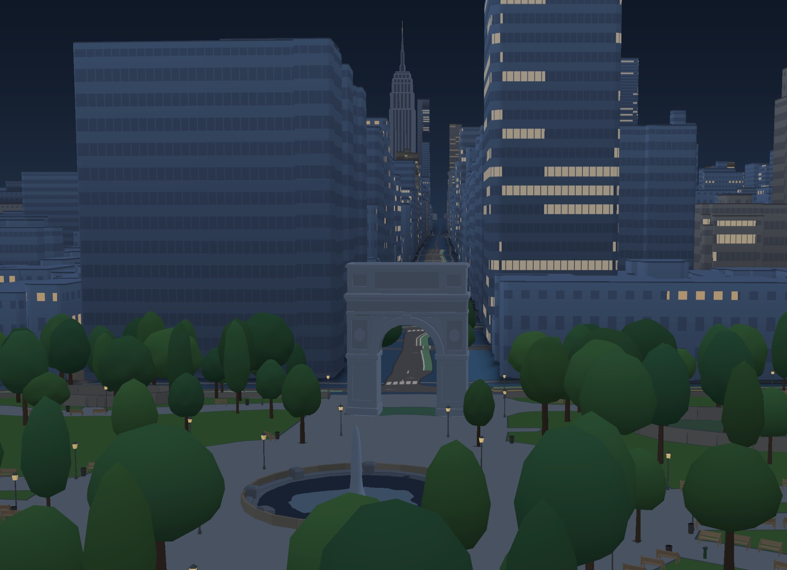

# Landmarks

**Low-poly 3D landmarks for maps.**



3D models of landmarks that replace a building's default extrusion on the
map. Each model is generated from code, has a few thousand triangles and no
textures, and uses a shared color palette.

500+ landmarks in New York, Chicago, Los Angeles, San Francisco, Charlotte,
Washington DC, Las Vegas, Seattle and a few theme parks.

The dataset is published at **https://alexwohlbruck.github.io/landmarks/**
in the [Open Landmarks](https://github.com/benjamintd/open-landmarks) format,
and is drawn in [Parchment](https://github.com/alexwohlbruck/parchment) via
[Barrelman](https://github.com/alexwohlbruck/barrelman).

## Getting started

You need [Bun](https://bun.sh). Nothing else.

```sh
git clone https://github.com/alexwohlbruck/landmarks
cd landmarks
bun install
```

| Command | Does |
|---|---|
| `bun generators/<id>.ts` | Build one model into `models/<id>.glb` |
| `bun run preview <id> [--night]` | Render a model from every side into `preview/<id>/` |
| `bun run sheet <id ...>` | Contact sheets for a list of landmarks |
| `bun run validate` | Check the catalog and every model |
| `bun test` / `bun run typecheck` | Tests and types |

## Contributing a model

Each landmark is a small TypeScript file in `generators/` that builds the
model from boxes, prisms and curves, and writes a GLB.

1. **Pick an id.** A lowercase slug, prefixed with its city or park:
   `nyc-brooklyn-bridge`, `chi-cloud-gate`, `carowinds-fury-325`.
2. **Gather evidence.** OSM footprints, published heights, photos from
   several sides. Note in the generator's header where each number came
   from. See [`docs/evidence.md`](docs/evidence.md) for what may be used.
3. **Write `generators/<id>.ts`** with the shared kit (`mesh.ts`,
   `palette.ts`, plus `coaster-kit.ts` or `bridge-kit.ts`). Good examples to
   copy from: `eiffel-tower.ts`, `chrysler-building.ts`,
   `carowinds-fury-325.ts`. Then run `bun generators/<id>.ts`.
4. **Look at it** with `bun run preview <id>`, and compare against photos.
5. **Add it to `catalog.json`**: a `models` entry and a `landmarks` entry
   placing it on the map, with the OSM buildings it `replaces`.
6. **Check it** with `bun run validate` and `bun test`.
7. **Open a pull request** with a contact sheet
   (`bun run sheet --branch-diff`).

Models made in Blender or elsewhere are welcome too, as long as they follow
the frame contract (+Y up, −Z north, metres, origin on the ground at the
anchor) and carry a licence the catalog can state.

## Generating models with Claude

Most models here were built by [Claude Code](https://claude.com/claude-code).
The repo ships two slash commands for it. Open Claude Code in the repo and
run one:

| Command | Does |
|---|---|
| `/new-landmark` | Builds one landmark. Asks which one, finds it in OSM, picks the id, gathers open evidence, writes the generator, checks it against photos and adds it to the catalog. |
| `/new-batch` | Leads a batch of 20 to 50 landmarks for a city or park. Asks which city, lets you edit the candidate list, runs builder sub-agents, reviews each model and opens a draft PR. |

You can name the target up front, as in `/new-landmark Fenway Park, Boston`
or `/new-batch Boston`, or run the command bare and answer its questions.

Review the renders against the photos before merging. The commands live in
[`.claude/skills/`](.claude/skills/) and follow the briefs in
[`docs/briefs/`](docs/briefs/) and the process in
[`docs/workflow.md`](docs/workflow.md).

### Before you start, read

- [`STYLE.md`](STYLE.md): the art style, the triangle budget, and what
  reviewers look for.
- [`docs/reference.md`](docs/reference.md): the catalog fields, the frame
  contract, elevation, bridges, what `replaces` must list, and how releases
  are built.
- [`docs/workflow.md`](docs/workflow.md): the full process for a batch of
  20 to 50 models, start to finish.

## Licence

Models and code are [CC0-1.0](LICENSE): public domain, no credit needed.
Placements are derived from OpenStreetMap and are ODbL-1.0,
© OpenStreetMap contributors.
