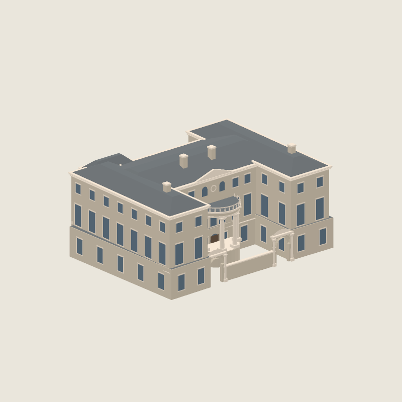

# Anderson House — draft for visual review

Original procedural model of the Society of the Cincinnati's headquarters at 2118 Massachusetts Avenue NW, Washington, DC. Creator: Salty Pancakes (`saltypancakes-1`); procedural modeling: OpenAI Codex (GPT-6).

[Front](front-render.png) · [Rear](rear-render.png) · [Night](night-render.png) · [Ground review](sheet-1.png)

## Evidence

- [OpenStreetMap way 66646611](https://www.openstreetmap.org/way/66646611), OSM contributors, ODbL. Footprint from the May 22, 2026 DC extract [archived here](https://github.com/kameronlee/heat-aware-pedestrian-routing/blob/456fd09d67aae857907e8c2b7fa6c19332734bd5/data/raw/osm/district-of-columbia-latest.osm.pbf).
- [NPS National Historic Landmark nomination](https://npgallery.nps.gov/NRHP/GetAsset/548abe2d-6b5f-498c-bf0f-eb61942fac68), architectural description on pages 4–5. Supports the U-shaped composition, curved portico, gateway arches, rear terrace and window types.
- [DC OCTO 2022 lidar, NOAA Digital Coast 9837](https://noaa-nos-coastal-lidar-pds.s3.amazonaws.com/laz/geoid18/9837/dc2022_wash_dc_metadata.html). Local DSM/DEM measurements relative to footprint p10 ground: main roof median 19.98 m; wing medians 19.07 and 19.16 m; portico median 12.59 m; rear terrace median 6.69 m. Local frame bearing 25.4°, anchor −77.04771675, 38.91071298.

## Photographic review

The user supplied three photographs and their source pages on November 20, 2026. The front was compared with [APK’s Commons photograph](https://commons.wikimedia.org/wiki/File:Larz_Anderson_House_-_Society_of_the_Cincinatti.jpg), CC BY 4.0. The images themselves are not redistributed in this repository.

The revised model has two window bays on each projecting front wing, shallower estimated hip roofs beneath the measured roof heights, heavier curved portico entablature, raised column bases, vase-shaped balcony balusters, window surrounds, and a central blind oculus. Garden arches and terrace balustrades follow the NPS architectural description.

| Render | Reference |
| --- | --- |
|  | [Front photograph — APK, CC BY 4.0](https://commons.wikimedia.org/wiki/File:Larz_Anderson_House_-_Society_of_the_Cincinatti.jpg) |
|  | [Historic oblique photograph source — SAH Archipedia](https://sah-archipedia.org/buildings/DC-01-DU34) |
|  | [Garden photograph source — Society virtual tour](https://www.societyofthecincinnati.org/anderson-house-virtual-tour/) |

The Society and SAH images have not been established as openly licensed; they are linked for provenance only. Rear geometry is based on the NPS description, OSM and lidar. The licensed multi-side and night photographic review remains incomplete, so the catalog retains **draft** status.

Visible differences from the front photograph: Corinthian capitals and pediment relief are abstract, masonry courses and dentils are omitted, window mullions and ornate gateway details are absent, and the courtyard excludes flags, statue and planting. Roof seams, chimney positions and exact facade depths remain approximate. The model’s restrained stone and slate colors do not reproduce photographic weathering. Garden awnings and sculpture are omitted. Night glazing is a display convention, not a verified lighting survey.

## Technical checks

Rechecked for geometry revision `c9189d65` on November 20, 2026. Release digest: `landmarks-bc29945cff036b62441c`.

- 5,368 triangles, 208,128 bytes, five materials, no textures.
- Stored replacement footprint refreshed for way 66646611.
- OSM overlap check passes against the archived neighborhood extract.
- Terrain check passes against local DC OCTO 2022 bare-earth data using the project's draping algorithm. This does not verify live Mapterhorn terrain.
- Front, rear and day/night render geometry inspected. Front comparison completed; other elevations remain provisional as described above.
- TypeScript and catalog validation pass.
- All 74 tests pass (13 test files, 758,439 assertions).
- Static build passes in a clean two-commit shallow checkout: 1,648 versions from two relevant commits, zero unavailable snapshots within that checkout. Older repository history is outside this build.
- Chromium smoke check passes: actual model loading, creator/AI credits, OSM reference, correctly hidden High/Low selector for this single-LOD model, and day/night model switching.

[200-pixel preview](phone-200.png) · [80-pixel preview](phone-80.png)
